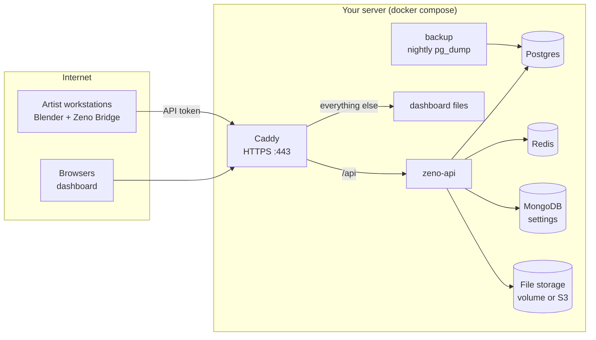

# Hosting Zeno

One server runs Zeno for many studios. Each studio signs up, gets its own private workspace
(projects, people, tasks, files), and invites its team by link.



## What you need

- A Linux server with Docker (Compose v2). 2 vCPU / 4 GB RAM is enough for a few small studios;
  disk depends on how much you publish (the CAS dedups repeated chunks).
- A domain name, e.g. `zeno.example.com`, with an **A record** pointing at the server.
- Ports **80** and **443** open. Nothing else needs to be reachable — the databases have no public ports.

## First deploy

```bash
git clone <your repos> zeno-repos          # zeno-api, zeno-dashboard, zeno-infra side by side
cd zeno-repos/zeno-infra/deploy
cp .env.prod.example .env.prod
# Fill in .env.prod: domain, Postgres password, and two secrets:
openssl rand -base64 48   # -> ZENO_JWT_SECRET
openssl rand -base64 48   # -> ZENO_LAUNCH_MINT_SECRET
docker compose -f docker-compose.prod.yml --env-file .env.prod up -d --build
```

Caddy fetches a Let's Encrypt certificate on first start. Open `https://zeno.example.com`,
click **Create a studio**, and you're the first admin.

The API refuses to start with unsafe settings in production: auth off, a missing/short JWT secret,
no file storage configured, or a `localhost` public URL.

### Open or invite-only?

`ZENO_ALLOW_SIGNUP=true` lets anyone create a studio (a public service).
Set it to `false` once your own studios exist; new people then join only through invite links.

## Storage for published files

| `CAS_STORAGE_BACKEND` | Where files live | Good for |
|---|---|---|
| `nas` (default) | The `cas_data` Docker volume on this server | Getting started, one server |
| `s3` | Any S3-compatible bucket: AWS S3, MinIO, Backblaze B2, Cloudflare R2 | Lots of data, durability, moving servers |

Files are content-addressed (named by their BLAKE3 hash) and deduplicated. Studios never see
each other's projects or versions; a file can only be fetched by someone who already knows its
64-character hash.

## Email invites (optional)

Fill the `ZENO_SMTP_*` values (any SMTP provider: Postmark, SES, Mailgun, Gmail app password…).
Without SMTP, the Team page shows a link to copy and share in Discord/Slack — invites work either way.

## Review media

Playblasts and renders submitted for review are converted on the server with ffmpeg (included
in the API image) into frame-accurate H.264 proxies, thumbnails and scrub strips; originals and
proxies are stored in the same file storage as published files. Conversion runs inside the API
container, `ZENO_REVIEW_WORKERS` at a time (default 1; each job uses about 1-2 CPU cores), and
interrupted jobs resume when the API restarts. Uploads are capped by `ZENO_REVIEW_MAX_UPLOAD_MB`
(default 4096). Client review links (`/r/<token>`) work without an account; they need nothing
extra from the proxy.

## Artists' machines

1. Install **Zeno Bridge** (see `zeno-bridge/README.md`) and give it your server:

   ```json
   {
     "api_base_url": "https://zeno.example.com",
     "allowed_origins": ["https://zeno.example.com"],
     "dcc_paths": { "blender": "/Applications/Blender.app/Contents/MacOS/Blender" },
     "executable_allowlist": ["/Applications/Blender.app/Contents/MacOS/Blender"]
   }
   ```

2. **Open in DCC** from the dashboard launches Blender already signed in as that artist
   (the launch carries a 24-hour token).
3. Optional: add a local media viewer (DJV, OpenRV) under `"viewers"` in the same config (and to
   `executable_allowlist`) to get an **Open in DJV** button on reviews for full-quality inspection.
4. Starting Blender by hand instead? Create a token under **Account → API tokens** and paste it in
   the add-on preferences (or set `ZENO_API_TOKEN`).

## Upgrades

```bash
cd zeno-repos && git pull            # in each repo
cd zeno-infra/deploy
docker compose -f docker-compose.prod.yml --env-file .env.prod up -d --build
```

`schema-init` applies database changes before the API starts (the schema file is idempotent).

## Backups and restore

The `backup` service writes a compressed `pg_dump` every 24 hours into the `backups` volume and
keeps `BACKUP_KEEP_DAYS` days. Copy them off the server regularly:

```bash
docker compose -f docker-compose.prod.yml --env-file .env.prod cp backup:/backups ./zeno-backups
```

Restore into a fresh stack:

```bash
docker compose -f docker-compose.prod.yml --env-file .env.prod exec -T postgres \
  pg_restore --clean --if-exists -U "$POSTGRES_USER" -d "$POSTGRES_DB" < zeno-YYYYMMDD-HHMMSS.dump
```

Published files are not in the database dump: back up the `cas_data` volume (or rely on your
S3 provider's durability/versioning).

## Health

`https://zeno.example.com/health` reports Postgres, Redis, MongoDB and storage status.

## Known limits (v1)

- A person belongs to one studio. Joining a second studio needs a second account (another email).
- No per-studio storage quotas or billing yet.
- Desktop integrations: Blender has a token field in its add-on preferences; the Maya entry point
  uses the same client, so it picks up `ZENO_API_TOKEN` or the Open-in-DCC token. Houdini and Nuke
  plugins don't exist yet.
